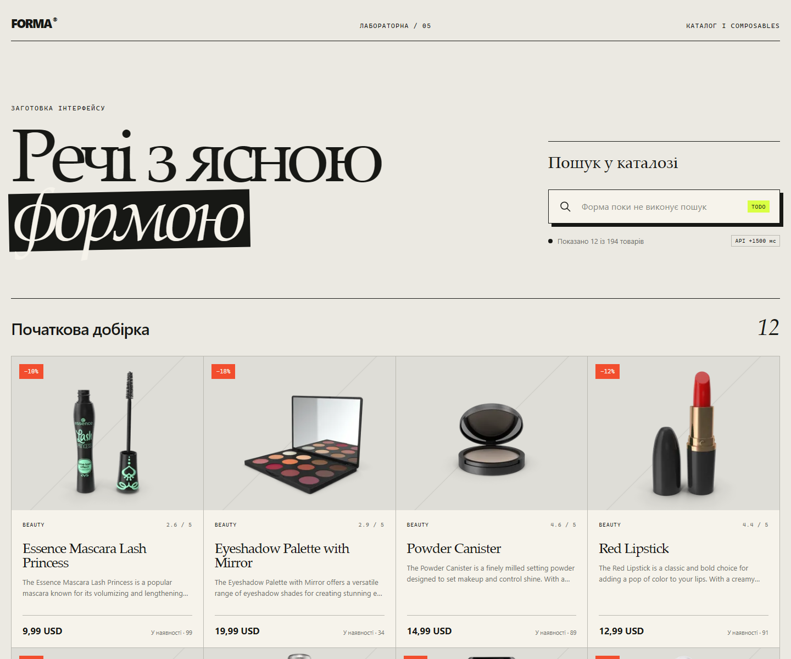

# Заготовка каталогу до лабораторної роботи № 5

Заготовка містить готовий адаптивний інтерфейс на Vue 3 і завантажує перші
12 товарів із DummyJSON. Початковий API-виклик, стани завантаження та помилки,
BEM-класи й оформлення вже працюють.

Дві можливості навмисно не реалізовано. Текстове поле не змінює запит до API,
а нижній блок не завантажує наступну сторінку. Уся розмітка поки розташована
в `App.vue`; межі майбутніх компонентів позначено коментарями `TODO`.



## Отримання та запуск

Скопіюйте стартер до каталогу `lab5` свого репозиторію:

```bash
git clone --depth 1 https://github.com/lisnayk/znu-lab-starters.git ../znu-lab-starters
cp -R ../znu-lab-starters/modern-frameworks/labs/05-composables/starter ./lab5
cd lab5
npm ci
npm run dev
```

Vite покаже локальну адресу застосунку. Для перевірки виробничої збірки
використовуйте `npm run build`.

## Початковий стан

- після затримки 1500 мс показано 12 товарів;
- введення `phone` не змінює каталог і не створює нового мережевого запиту;
- прокручування до нижнього блока не завантажує наступні товари;
- повторний запит доступний після помилки початкового завантаження;
- вихідна розмітка зосереджена в `App.vue` й потребує розподілу за
  відповідальністю.

Повний хід роботи, контракти компонентів і критерії перевірки наведено в Moodle.
