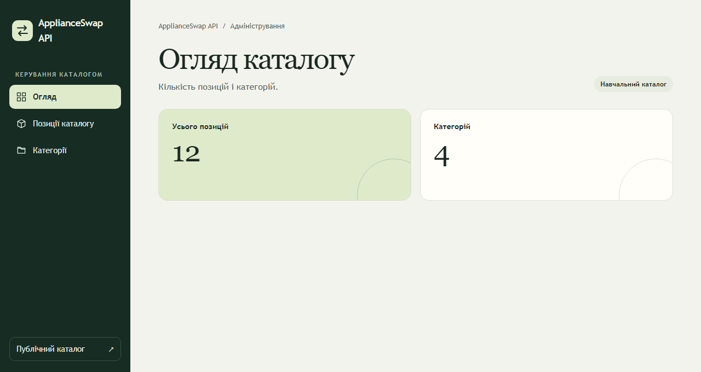
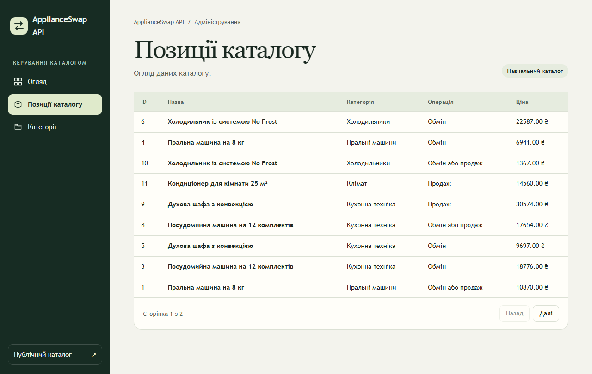
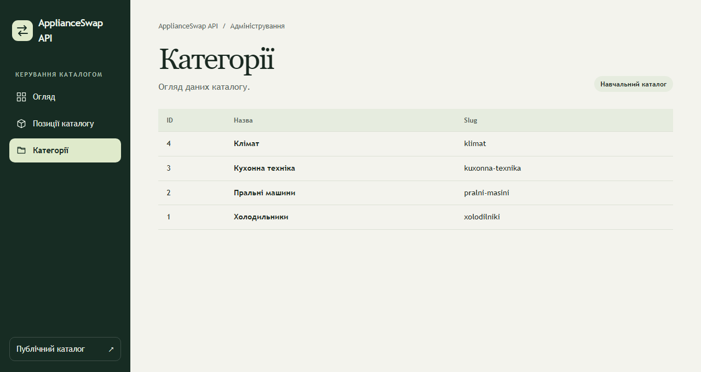

# Лабораторна робота № 5. Каркас адмінпанелі

Каркас містить спільне меню Blade, контейнер для React і стилі для трьох
сторінок адмінпанелі. Його використовують у копії застосунку лабораторної
роботи № 4.

1. Завантажте цей каталог і перенесіть папку `resources` до `lab5`, зберігаючи
   шляхи файлів.
2. Запустіть Laravel через Docker Compose за інструкцією у своєму проєкті.
3. Додайте маршрути та підключіть `resources/css/admin.css` і власний
   `resources/js/admin.jsx` у конфігурації Vite. Зберіть застосунок з `lab5`
   командою `npm run build` після підключення React.

| Файл | Призначення |
| --- | --- |
| `resources/views/admin/index.blade.php` | Меню, заголовок і контейнер для React |
| `resources/css/admin.css` | Стилі меню, показників і таблиць |

Показники, таблиці й завантаження даних з API реалізуйте за ходом роботи.
Кольори можна змінити в CSS-змінних блока `.admin-shell`.

## Вигляд після виконання роботи

### Огляд каталогу

### Позиції каталогу

### Категорії

